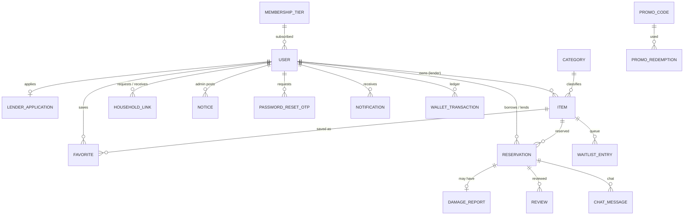

# Database Schema (MongoDB + Mongoose)

All models live in `server/src/models/`, one file per collection. Sprint 1 models are used immediately; Sprint 2 models are
**already defined** so the schema never has to be restructured mid-project (NFR 11: new categories and membership tiers are
*documents*, not code).

## Entity relationships

## Sprint 1 collections

| Collection | Purpose | Key fields | Indexes |
|---|---|---|---|
| **users** | Every account (member, verified lender, admin) | `username`, `name`, `email`, `phone`, `address{}`, `passwordHash` (bcrypt, `select:false`), `role` (member/admin), `lenderStatus` (none/pending/verified/rejected), `status` (active/suspended), `walletBalance`, `trustScore`, `stats{}`, `membership{}`, `notificationPrefs{}` | unique: username, email, phone, referralCode(sparse) |
| **lenderapplications** | One application per user (Req 2, 3, 8, 9) | `user`, `status` (draft/pending/approved/rejected), `documents[]` (`type`: id_document/proof_of_address, stored path, mime, size), `reviewedBy`, `rejectionReason` | unique: user |
| **passwordresetotps** | OTP password reset (Req 11) | `user`, `email`, `otpHash`, `expiresAt` (TTL), `attempts`, `usedAt` | TTL on expiresAt |
| **categories** | Item categories (data, not enum) | `name`, `slug`, `depositMultiplier` (Req 40), `isActive` | unique: name, slug |
| **items** | Listings (Req 13–15, 30–33) | `owner`, `title`, `category`, `description`, `photos[]`, `conditionNotes`, `depositAmount`, `pickup{}`, `rules{maxBorrowDays,minTrustScore}`, `manual{}`, `isArchived`, `moderationStatus`, `delivery{}`, `tags[]` | text(title, description); category+isArchived+moderationStatus |
| **householdlinks** | Link two accounts (Req 24–27) | `requester`, `recipient`, `relation` (spouse/child/parent), `status` (pending/accepted/declined), `activeKey` | unique sparse: activeKey (one live link per pair) |
| **favorites** | Wishlist (Req 37, 38) | `user`, `item` | unique: user+item |
| **notices** | Community notices (Req 41, 42) | `title`, `body`, `postedBy`, `pinned` | pinned+createdAt |

## Sprint 2 collections (defined, unused in Sprint 1)

`membershiptiers`, `reservations` (deposit breakdown, payment, delivery, extension, cancellation, condition photos),
`borrowlists`, `waitlistentries`, `damagereports`, `reviews`, `notifications`, `chatmessages`, `reports`, `promocodes`,
`promoredemptions`, `referrals`, `supporttickets`, `wallettransactions` (wallet ledger), `auditlogs` (NFR 14: every deposit/refund calculation).

## Design decisions worth knowing

- **Roles**: `role` is `member` or `admin`. A *verified lender* is a member with `lenderStatus = 'verified'`
  (a lender can still borrow). Middleware: `requireRole('admin')`, `requireVerifiedLender`.
- **Passwords**: never stored in plain text; `user.setPassword()` uses a per-password salt (bcrypt) — NFR 3.
- **Money** is stored in EGP as a Number. Round to 2 decimals when computing deposits/refunds.
- **Archived items** keep their reservation history: nothing is deleted, `isArchived` just hides them — always query with `Item.publicFilter()`.
- **Documents** for lender applications live on disk in `server/uploads/private/` and are streamed only through admin/owner endpoints.
- **Household links** hold the *relationship*; benefits (Sprint 2, Req 88) are computed by looking up accepted links at reservation time.
- **Trust score** fields exist on `users` now (Req 31 reads `trustScore`); Sprint 2 recalculates them (Req 99).
